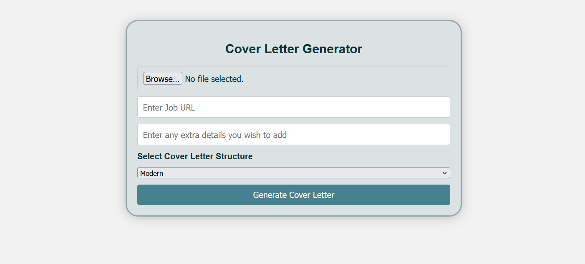
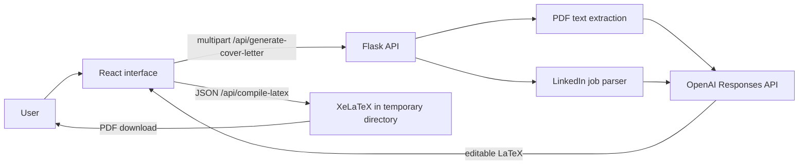

# Auto Cover Letter

Auto Cover Letter is a completed hackathon MVP that turns a PDF resume and a
LinkedIn job posting into editable LaTeX, then compiles the reviewed result into
a downloadable PDF.

> **Project status:** the original personal-server deployment has been retired,
> so there is no live demo. This repository contains the runnable source,
> automated tests, a safe screenshot, and a record of the original project.



## What it does

1. A React form collects a PDF resume, LinkedIn job URL, writing tone, and
   optional context.
2. Flask validates the request and extracts text from the PDF in memory.
3. The backend retrieves the public LinkedIn job description and builds a
   fact-constrained prompt.
4. The OpenAI Responses API returns LaTeX that follows the version-controlled
   template.
5. The user reviews or revises the LaTeX before XeLaTeX creates the PDF.



## Technology

- **Frontend:** React, Vite, JavaScript, Vitest, React Testing Library
- **Backend:** Python, Flask, pypdf, Beautiful Soup, Requests
- **Generation:** OpenAI Responses API and a version-controlled LaTeX template
- **Document output:** XeLaTeX
- **Delivery:** GitHub Actions, with the original deployment served from a
  personal Linux host behind Nginx and Cloudflare

The 2025 hackathon implementation used `gpt-4o-mini`. The showcase version uses
the model configured by `OPENAI_MODEL` and defaults to `gpt-6-luna`. The Python
adapter follows the current [OpenAI text-generation guidance](https://developers.openai.com/api/docs/guides/text)
by using the Responses API, high-priority instructions, and `response.output_text`.

## Team and ownership

Three developers implemented the software during the March 29-30, 2025
DataQuest hackathon. Eunsung Kim was part of the initial group but had to leave
before development and later helped where possible with presentation work.

| Contributor | Primary project work |
| --- | --- |
| **Nicholas Woo** | React workflow and UX, frontend/backend integration, Flask routes, resume parsing, PDF download flow, loading feedback, and later Linux deployment adaptation |
| **Josh Muszka** | LinkedIn job scraping, LaTeX/PDF pipeline work, integration, and visual improvements |
| **Michael Quick** | OpenAI integration, backend structure and cleanup, lint automation, integration, and presentation work |
| **Eunsung Kim** | Initial team member and presentation support when available |

Nicholas's original work is visible in the repository history:

- [PR #7](https://github.com/raginggoosedev/auto-cover-letter/pull/7): initial application form and React workflow
- [PR #13](https://github.com/raginggoosedev/auto-cover-letter/pull/13): selectable style and feedback-based regeneration
- [PR #18](https://github.com/raginggoosedev/auto-cover-letter/pull/18): API integration, resume parsing, LaTeX compilation, and PDF download
- [PR #19](https://github.com/raginggoosedev/auto-cover-letter/pull/19): asynchronous loading feedback
- [Deployment commit](https://github.com/raginggoosedev/auto-cover-letter/commit/18a5473dc54f5bd0be7243b89011028f7bdfea6f): same-origin `/api` routing and WSGI deployment entry point

## Run locally

### Prerequisites

- Python 3.11 or newer
- [uv](https://docs.astral.sh/uv/)
- Node.js 22.12 or newer and npm
- A XeLaTeX distribution available on `PATH`
- An OpenAI API key

### Configuration

From the repository root, copy `env.example` to `.env` and add your API key:

```dotenv
OPENAI_API_KEY=your-key-here
OPENAI_MODEL=gpt-6-luna
CORS_ORIGINS=http://localhost:5173
FLASK_DEBUG=0
```

Never commit `.env`. The included `.gitignore` excludes it.

### Backend

```bash
uv sync --project backend --extra dev
uv run --project backend python -m backend.routes.main
```

The health endpoint is `GET http://localhost:5000/api/health`.

### Frontend

In another terminal:

```bash
cd frontend
npm ci
npm run dev
```

The React development server proxies `/api` to Flask on port 5000.

## API

| Endpoint | Request | Success response |
| --- | --- | --- |
| `GET /api/health` | None | `{ "status": "ok" }` |
| `POST /api/generate-cover-letter` | Multipart fields: `resume`, `jobUrl`, optional `extraDetails`, optional `comments`, and `tone` | `{ "coverLetter": "..." }` |
| `POST /api/compile-latex` | JSON: `{ "latex": "..." }` | `application/pdf` |

Errors use `{ "error": "human-readable message" }`. Resume uploads must be
text-readable PDFs no larger than 5 MiB. Supported tones are `modern`,
`traditional`, and `creative`.

## Tests and CI

Backend tests mock LinkedIn, OpenAI, and XeLaTeX, so they do not send personal
data, consume API credits, or require the retired server.

```bash
uv run --project backend pytest backend/tests --cov=backend --cov-config=backend/pyproject.toml --cov-report=term-missing --cov-fail-under=90
uv run --project backend pylint backend/llm backend/routes backend/scraping backend/latex

cd frontend
npm run test:ci
npm run build
```

GitHub Actions runs the same backend lint/tests and frontend tests/build on pull
requests to `main`.

## Privacy, security, and limitations

- Resume and job text are sent to the configured OpenAI API project. Review the
  applicable data controls before processing personal information.
- Resume text is parsed in memory and is not intentionally persisted by the
  application. Model response storage is disabled in the API call.
- XeLaTeX runs with shell escape disabled, a time limit, and a unique temporary
  directory. A public production service would still require stronger container
  isolation and resource controls.
- LinkedIn's public page markup can change, which can break the scraper.
- This MVP has no accounts, database, job history, or multi-user support.
- Generated content still requires human review before it is used.

## Hackathon record and later hardening

The product was built during a weekend under a demo deadline using personal
feature branches, frequent pull requests, and repeated integration. It was a
lightweight Agile workflow, not formal Scrum.

The original presentation has been converted to a
[sanitized written summary](docs/original-presentation.md). The binary deck was
removed from the current branch because its demo screenshots contained personal
contact information. See [showcase hardening](docs/showcase-hardening.md) for a
clear separation between the original hackathon work and later improvements.

## License

[MIT](LICENSE) © 2025 Raging Goose Dev.
