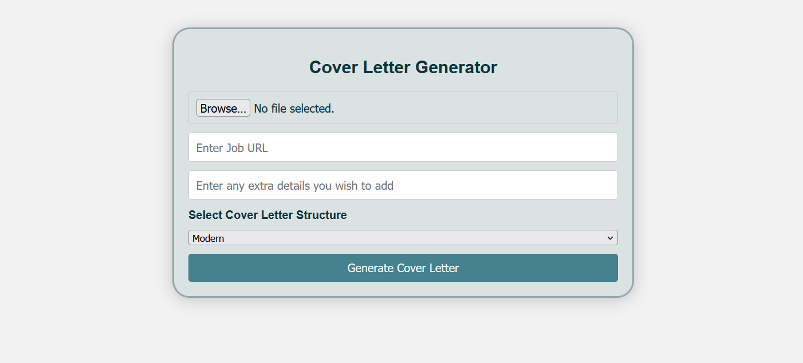

# Original DataQuest 2025 Presentation — Sanitized Summary

This document preserves the substance of the team's original 13-slide pitch
without republishing screenshots that contained personal contact information.

## Team

- Michael Quick
- Josh Muszka
- Eunsung Kim
- Nicholas Woo

Three members implemented the software. Eunsung had to leave before development
began and later attempted to help with presentation work.

## Pitch outline

1. **Problem:** applicants need tailored cover letters, but repeatedly rewriting
   them takes time and generic form letters do not stand out.
2. **Solution:** combine a resume, job posting, and selected writing approach to
   create a tailored cover letter with an AI model.
3. **Workflow:** React collects the inputs; the server extracts resume text and
   job details; the model returns LaTeX; XeLaTeX creates an ATS-friendly PDF.
4. **Benefits:** approachable interface, quick generation, editable output, and
   consistent PDF formatting.
5. **Future work:** compare models, improve templates, expand to resume support,
   improve privacy, collect user feedback, and refactor for maintainability.

## Original interface

The screenshot reflects the hackathon version. The current showcase changes the
unused “structure” choice into a writing-tone input and adds explicit privacy,
validation, and error feedback.
